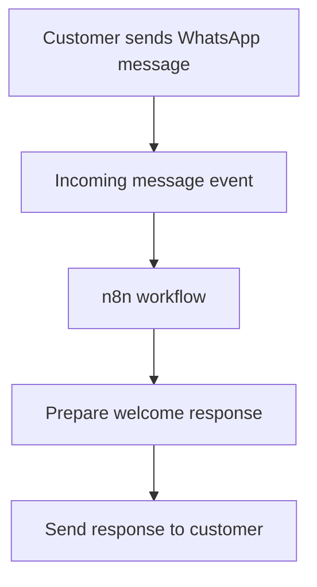

# Workflow Architecture

## Purpose

This document describes the confirmed high-level design of the WhatsApp Business automated first-response project.

## High-level flow

## Components

| Component | Responsibility |
|---|---|
| WhatsApp Business channel | Receives the customer's message and provides the messaging interface |
| Incoming event / trigger | Starts the automation when a customer message is received |
| n8n | Orchestrates the workflow steps |
| Welcome response | Introduces the business and invites product, price, availability, and delivery enquiries |

## Implementation details to verify

The original workflow configuration is required to confirm:
- The WhatsApp integration provider and trigger type
- The exact n8n nodes and their configuration
- How the incoming event is authenticated and parsed
- The outbound messaging endpoint and payload
- Whether duplicate events, unsupported message types, or failed sends are handled

These details are intentionally left open rather than guessed.
